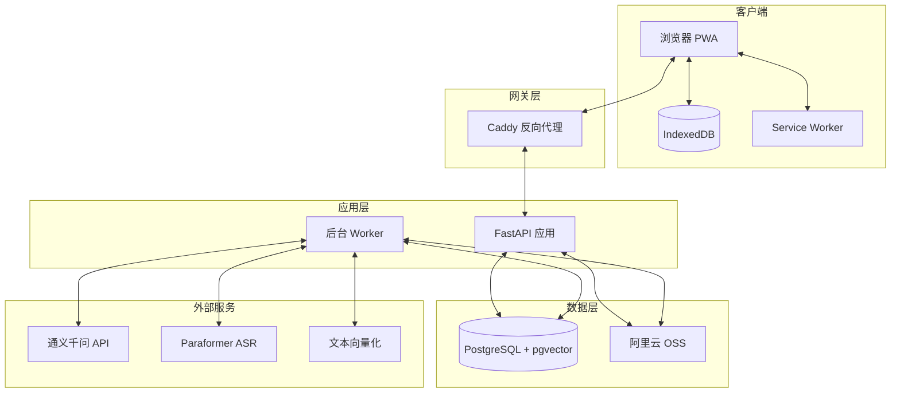

# 系统架构

## 概览

本项目采用前后端分离架构，后端基于 FastAPI 提供 RESTful API，前端使用 React 构建 PWA 应用，支持离线使用。



## 核心组件

### 1. 前端 (React + PWA)

**职责:**
- 用户界面展示和交互
- 离线数据缓存 (IndexedDB)
- 事件队列管理 (Outbox Pattern)
- 自动同步与冲突处理

**技术栈:**
- React 18 + TypeScript
- TanStack Query (服务端状态)
- React Hook Form (表单管理)
- Dexie.js (IndexedDB 封装)
- Vite (构建工具)

### 2. 后端 API (FastAPI)

**职责:**
- 用户认证和授权
- 业务逻辑处理
- Agent 工作流编排
- 数据库操作
- 后台任务创建

**关键模块:**
- `auth`: 邀请码、注册、登录、会话管理
- `profiles`: 用户档案和记忆管理
- `plans`: 训练计划生成和版本管理
- `workouts`: 训练记录和统计
- `knowledge`: 知识库导入和检索
- `agent`: AI 工作流编排
- `sync`: 离线同步幂等性处理

### 3. 后台 Worker

**职责:**
- 轮询任务队列
- 执行异步任务
- 处理长时间运行的操作

**任务类型:**
- 知识导入 (视频转写、分块、向量化)
- 计划生成
- 周度复盘
- 用户数据导出
- 系统维护

### 4. 数据库 (PostgreSQL + pgvector)

**职责:**
- 持久化业务数据
- 向量相似度检索
- 行级安全 (RLS)
- 事务保证

**关键表:**
- 用户和认证
- 档案和记忆
- 内容目录 (动作、模板)
- 计划版本
- 训练记录
- 知识库
- 任务队列
- 模型调用日志

### 5. 对象存储 (阿里云 OSS)

**职责:**
- 存储媒体文件
- 加密备份
- 临时文件管理

**存储类别:**
- 持久资源 (文档、转写)
- 临时导入 (原始视频, 7 天过期)
- 导出文件 (24 小时过期)
- 备份 (独立 Bucket)

## 数据流

### 1. 训练记录流程 (离线优先)

```
用户操作 → IndexedDB Outbox
         → 联网后同步到服务器
         → 服务器幂等性验证
         → 写入 PostgreSQL
         → 返回确认 + 版本号
         → 更新本地快照
```

### 2. 计划生成流程

```
用户请求 → API 接收
        → 创建后台任务
        → Worker 执行
          → 读取档案和约束
          → 检索知识库 (RAG)
          → 调用 Qwen API
          → 验证输出 (Pydantic + 领域规则)
          → 保存草稿
        → 返回计划差异
        → 用户采用 → 激活新版本
```

### 3. 知识导入流程

```
上传文件 → API 接收
        → 验证格式和大小
        → 计算 SHA256
        → 上传到 OSS
        → 创建导入任务
        → Worker 处理
          → 提取音频 (FFmpeg)
          → 提交 ASR (Paraformer)
          → 轮询结果
          → 分块处理
          → 生成向量 (Qwen Embedding)
          → 等待人工审核
          → 审核通过 → 可检索
```

## 安全设计

### 1. 认证与授权

- 邀请制注册 (72 小时有效期)
- Argon2id 密码哈希
- 会话令牌 (256 位, 7 天有效)
- CSRF 保护
- 速率限制

### 2. 数据隔离

- 行级安全 (RLS) 强制用户隔离
- 非超级用户数据库角色
- 私有 OSS Bucket + 签名 URL
- 查询中强制 `user_id` 过滤

### 3. API 安全

- HTTPS 强制
- CORS 配置
- 输入验证 (Pydantic)
- SQL 注入防护 (参数化查询)
- 秘钥管理 (环境变量, 不提交代码)

## 扩展性考虑

### 当前设计 (2-5 用户)

- 单服务器部署
- 2 核 4GB 内存
- 共享 PostgreSQL 实例
- API + Worker 同主机

### 未来扩展路径 (如需要)

- 水平扩展 API (多实例 + 负载均衡)
- 独立 Worker 节点
- Redis 缓存层
- PostgreSQL 读写分离
- CDN 加速静态资源

## 监控与运维

### 健康检查

- `/health`: API 健康状态
- PostgreSQL 连接测试
- OSS 可达性测试

### 日志

- 结构化 JSON 日志
- 30 天保留
- 包含: 请求 ID, 用户 ID, 操作类型, 耗时

### 指标

- 模型调用次数和成本
- API 响应时间
- 后台任务成功率
- 数据库连接池使用率

### 备份

- 每日 03:00 自动备份
- 加密后上传到独立 Bucket
- 本地 Windows PC 同步副本
- 保留: 最近 7 天 + 最近 4 周
