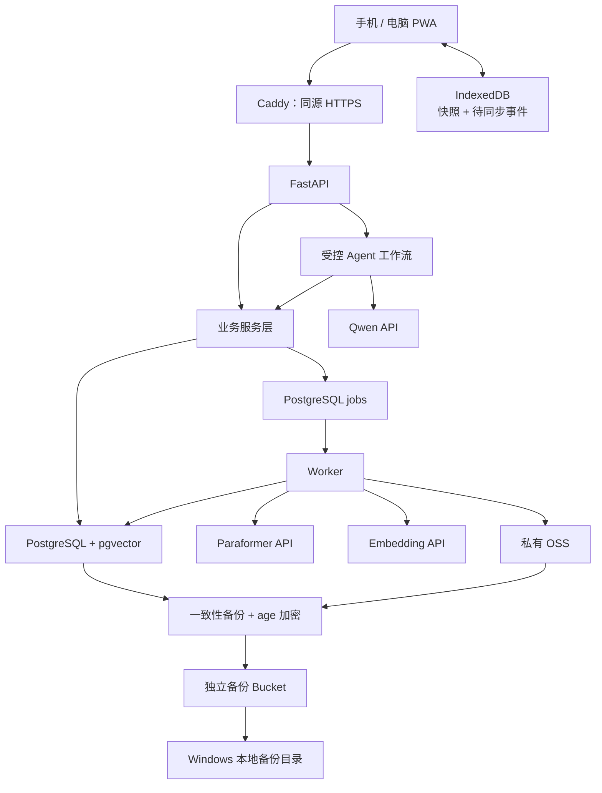

# 私人健身教练 Agent

版本：V1.0  
目标项目目录：`D:\py\muscle_training`  
文档性质：完整实施规格，替代此前较概括的方案。

本规格中的目录、文件、接口和数据表均为**需要实施的目标结构**，不表示当前项目已经存在这些内容。

---

## 1. 项目目标与固定决策

### 1.1 要实现的产品

开发一个供本人和少量朋友使用的私人健身教练应用，支持：

1. 建立个人训练档案。
2. 导入健身视频、字幕和文档，建立可追溯知识库。
3. 根据个人条件生成训练计划草稿。
4. 展示计划依据、动作说明和资料引用。
5. 记录实际训练、体重和基础饮食。
6. 根据实际记录生成每周复盘和计划调整建议。
7. 手机离线记录，联网后同步。
8. 云端长期保存数据，电脑定期保存可恢复备份。
9. 不同用户之间隔离个人资料。

核心业务闭环：

```text
建档
→ 制定计划
→ 用户采用
→ 训练前状态确认
→ 执行并记录
→ 统计实际完成情况
→ 周复盘
→ 提出调整
→ 用户采用新版本
```

### 1.2 已确定的约束

| 项目 | 固定决定 |
|---|---|
| 用户数量 | 第一版按 2–5 人设计 |
| 使用地区 | 中国大陆，优先国内直连 |
| 用户入口 | 响应式网页，支持 PWA |
| 部署方式 | 云端主用，手机离线缓存，电脑本地备份 |
| 数据权威来源 | 云端 PostgreSQL |
| 模型运行 | 调用 API，不本地部署大模型 |
| 运行预算 | 整个小团队目标 100–300 元/月，不含开发人工 |
| 用户体系 | 邀请制，不开放公众注册 |
| 主要语言 | 简体中文 |
| 默认时区 | Asia/Shanghai，可按用户修改 |
| 单位 | kg、cm、秒；字段必须明确单位 |
| Agent 形式 | 单个受控工作流，不使用多 Agent 自由讨论 |
| 长期记忆 | 结构化数据为主，摘要为辅 |
| RAG | 关键词检索与向量检索结合 |
| 计划采用 | 必须由用户明确采用，模型不能直接替换生效计划 |
| API 密钥 | 只保存在后端或运维环境中 |

### 1.3 第一版不实现

- 本人动作视频自动纠错。
- 实时摄像头训练指导。
- 医学诊断、康复处方。
- 食物照片自动精确计算热量。
- 可穿戴设备接入。
- 微信小程序及原生移动 App。
- 公开商业收费与支付。
- 本地、云端两个数据库之间的任意双向同步。
- 模型微调。
- Redis、Celery、独立向量数据库、Kubernetes。
- 自动下载博主全部视频。
- 短信、邮件、微信推送。

### 1.4 必须遵守的领域原则

- **知识资料不等于个人事实。**
- **计划目标不等于实际完成。**
- **未记录不等于没有训练。**
- **模型推断不等于用户已确认事实。**
- **生成合法 JSON 不等于建议正确。**
- **有引用不等于引用支持该结论。**
- **本地缓存不等于备份。**
- **使用模型 API 不等于无需业务数据库。**

朋友提出的“肩胛骨不够灵活”“髋关节需要重点练”等内容，不能自动成为已确认身体结论。系统应保留其来源和确认状态。

---

## 2. 技术栈与系统架构

### 2.1 固定技术栈

| 层次 | 选择 |
|---|---|
| Python | 3.12 |
| Node.js | 24 LTS |
| Python 包管理 | uv |
| 前端包管理 | pnpm 10 |
| 前端 | React、TypeScript、Vite |
| 页面路由 | React Router |
| 前端服务端状态 | TanStack Query |
| 前端表单 | React Hook Form |
| 本地数据库 | Dexie / IndexedDB |
| API 客户端 | openapi-fetch |
| API 类型生成 | openapi-typescript |
| 后端 | FastAPI |
| 数据验证 | Pydantic 2 |
| ORM | SQLAlchemy 2 |
| PostgreSQL 驱动 | asyncpg |
| 数据库迁移 | Alembic |
| 数据库 | PostgreSQL 17 |
| 向量扩展 | pgvector |
| 中文分词 | jieba，附动作别名字典 |
| HTTP 请求 | httpx |
| 密码哈希 | Argon2id |
| 媒体处理 | FFmpeg / ffprobe |
| 后台任务 | PostgreSQL 任务表 + 独立 Python Worker |
| 生产对象存储 | 阿里云 OSS 私有 Bucket |
| 开发对象存储 | 本地文件目录 |
| 反向代理 | Caddy |
| 部署 | Docker Compose |
| 备份加密 | age |
| 后端测试 | pytest、pytest-asyncio |
| 前端测试 | Vitest、Testing Library |
| 端到端测试 | Playwright |
| Python 静态检查 | Ruff |
| 前端检查 | ESLint、TypeScript |

实施时在上述主版本范围内选择稳定兼容版本，生成并提交锁文件。生产镜像固定版本及镜像摘要，不使用浮动 `latest`。

Node.js 和 PostgreSQL 的支持状态以官方发布政策为依据。[Node.js 发布说明](https://nodejs.org/en/about/previous-releases)、[PostgreSQL 版本政策](https://www.postgresql.org/support/versioning/)

### 2.2 模型默认配置

| 用途 | 默认模型或方式 |
|---|---|
| 对话、计划、资料整理、复盘 | `qwen-plus-2025-12-01` |
| 思考模式 | 关闭 |
| 输出格式 | JSON Object |
| 文本向量 | `qwen3.7-text-embedding` |
| 向量维度 | 1024 |
| 文件语音转写 | `paraformer-v2` |
| 视觉分析 | 第一版不接入 |
| 接入地域 | 百炼北京地域 |

Qwen-Plus 的 JSON Object 模式不保证字段严格符合业务结构，必须在后端校验；不能假定它支持严格 JSON Schema。[百炼结构化输出文档](https://help.aliyun.com/zh/model-studio/qwen-structured-output)

### 2.3 部署组件

生产环境运行以下组件：

```text
Caddy
├── 提供前端静态文件
└── 将 /api/* 转发到 FastAPI

FastAPI
├── 用户认证与业务 API
├── Agent 交互流程
└── 创建后台任务

Worker
├── 处理素材导入
├── 轮询转写任务
├── 生成计划和周复盘
├── 导出用户数据
└── 执行定期维护任务

PostgreSQL + pgvector
├── 业务事实
├── 计划版本
├── 记忆
├── 知识片段与向量
└── 任务和用量记录

OSS
├── 持久资料
├── 临时媒体
└── 独立备份 Bucket
```

一台 CPU 云服务器即可承载 Caddy、FastAPI、Worker 和 PostgreSQL。第一版按 2 核、4GB 内存作为资源预算起点，最终以并发与媒体处理实测确认。

### 2.4 架构图



---

## 3. 完整目标目录结构

以下相对路径均以 `D:\py\muscle_training` 为根目录。

```text
D:\py\muscle_training\
├── README.md
├── AGENTS.md
├── .env.example
├── .gitignore
├── .dockerignore
├── package.json
├── pnpm-workspace.yaml
├── pnpm-lock.yaml
├── compose.dev.yml
├── compose.test.yml
├── compose.prod.yml
│
├── contracts\
│   └── openapi.json
│
├── apps\
│   ├── api\
│   │   ├── pyproject.toml
│   │   ├── uv.lock
│   │   ├── alembic.ini
│   │   ├── Dockerfile
│   │   ├── migrations\
│   │   │   ├── env.py
│   │   │   └── versions\
│   │   │
│   │   ├── src\
│   │   │   └── app\
│   │   │       ├── __init__.py
│   │   │       ├── main.py
│   │   │       ├── config.py
│   │   │       ├── cli.py
│   │   │       │
│   │   │       ├── api\
│   │   │       │   ├── router.py
│   │   │       │   ├── dependencies.py
│   │   │       │   ├── middleware.py
│   │   │       │   └── errors.py
│   │   │       │
│   │   │       ├── db\
│   │   │       │   ├── base.py
│   │   │       │   ├── session.py
│   │   │       │   ├── scope.py
│   │   │       │   └── models\
│   │   │       │       ├── __init__.py
│   │   │       │       ├── auth.py
│   │   │       │       ├── profile.py
│   │   │       │       ├── catalog.py
│   │   │       │       ├── training.py
│   │   │       │       ├── nutrition.py
│   │   │       │       ├── knowledge.py
│   │   │       │       ├── memory.py
│   │   │       │       └── operations.py
│   │   │       │
│   │   │       ├── modules\
│   │   │       │   ├── auth\
│   │   │       │   ├── profiles\
│   │   │       │   ├── catalog\
│   │   │       │   ├── plans\
│   │   │       │   ├── workouts\
│   │   │       │   ├── measurements\
│   │   │       │   ├── nutrition\
│   │   │       │   ├── knowledge\
│   │   │       │   ├── memory\
│   │   │       │   ├── reviews\
│   │   │       │   ├── conversations\
│   │   │       │   ├── sync\
│   │   │       │   ├── exports\
│   │   │       │   └── deletion\
│   │   │       │
│   │   │       ├── agent\
│   │   │       │   ├── orchestrator.py
│   │   │       │   ├── context_builder.py
│   │   │       │   ├── tools.py
│   │   │       │   ├── schemas.py
│   │   │       │   ├── limits.py
│   │   │       │   ├── output_validation.py
│   │   │       │   └── prompts\
│   │   │       │       ├── system.md
│   │   │       │       ├── classify_intent.md
│   │   │       │       ├── answer_question.md
│   │   │       │       ├── generate_plan.md
│   │   │       │       ├── adjust_plan.md
│   │   │       │       ├── parse_workout.md
│   │   │       │       ├── extract_memory.md
│   │   │       │       ├── weekly_review.md
│   │   │       │       ├── extract_knowledge.md
│   │   │       │       └── repair_output.md
│   │   │       │
│   │   │       ├── providers\
│   │   │       │   ├── interfaces.py
│   │   │       │   ├── qwen_chat.py
│   │   │       │   ├── qwen_embedding.py
│   │   │       │   ├── paraformer.py
│   │   │       │   ├── errors.py
│   │   │       │   └── fake.py
│   │   │       │
│   │   │       ├── rag\
│   │   │       │   ├── normalization.py
│   │   │       │   ├── chunking.py
│   │   │       │   ├── indexing.py
│   │   │       │   ├── retrieval.py
│   │   │       │   ├── fusion.py
│   │   │       │   └── citations.py
│   │   │       │
│   │   │       ├── media\
│   │   │       │   ├── validation.py
│   │   │       │   ├── audio_extract.py
│   │   │       │   └── subtitles.py
│   │   │       │
│   │   │       ├── storage\
│   │   │       │   ├── interfaces.py
│   │   │       │   ├── filesystem.py
│   │   │       │   └── oss.py
│   │   │       │
│   │   │       ├── jobs\
│   │   │       │   ├── worker.py
│   │   │       │   ├── scheduler.py
│   │   │       │   ├── queue.py
│   │   │       │   ├── leases.py
│   │   │       │   └── handlers\
│   │   │       │       ├── import_knowledge.py
│   │   │       │       ├── generate_plan.py
│   │   │       │       ├── weekly_review.py
│   │   │       │       ├── export_user.py
│   │   │       │       ├── delete_user.py
│   │   │       │       └── maintenance.py
│   │   │       │
│   │   │       └── backup\
│   │   │           ├── snapshot.py
│   │   │           ├── manifest.py
│   │   │           ├── encryption.py
│   │   │           ├── retention.py
│   │   │           └── restore.py
│   │   │
│   │   └── tests\
│   │       ├── conftest.py
│   │       ├── unit\
│   │       ├── integration\
│   │       ├── live\
│   │       └── fixtures\
│   │
│   └── web\
│       ├── package.json
│       ├── tsconfig.json
│       ├── vite.config.ts
│       ├── vitest.config.ts
│       ├── playwright.config.ts
│       ├── index.html
│       ├── public\
│       │   └── icons\
│       ├── src\
│       │   ├── main.tsx
│       │   ├── app\
│       │   │   ├── router.tsx
│       │   │   ├── providers.tsx
│       │   │   └── AppShell.tsx
│       │   ├── api\
│       │   │   ├── client.ts
│       │   │   ├── errors.ts
│       │   │   └── generated\
│       │   │       └── schema.ts
│       │   ├── features\
│       │   │   ├── auth\
│       │   │   ├── onboarding\
│       │   │   ├── today\
│       │   │   ├── workouts\
│       │   │   ├── history\
│       │   │   ├── plans\
│       │   │   ├── chat\
│       │   │   ├── nutrition\
│       │   │   ├── knowledge\
│       │   │   ├── reviews\
│       │   │   └── settings\
│       │   ├── offline\
│       │   │   ├── database.ts
│       │   │   ├── migrations.ts
│       │   │   ├── outbox.ts
│       │   │   ├── sync_engine.ts
│       │   │   ├── snapshot_cache.ts
│       │   │   └── account_boundary.ts
│       │   ├── components\
│       │   │   ├── SyncStatus.tsx
│       │   │   ├── CitationLink.tsx
│       │   │   ├── PlanDiff.tsx
│       │   │   ├── ErrorState.tsx
│       │   │   └── ConfirmAction.tsx
│       │   ├── pwa\
│       │   │   ├── service-worker.ts
│       │   │   └── update_manager.ts
│       │   └── styles\
│       │       └── global.css
│       └── tests\
│           ├── unit\
│           └── e2e\
│
├── content\
│   ├── README.md
│   ├── schemas\
│   │   ├── exercise.schema.json
│   │   ├── template.schema.json
│   │   └── source.schema.json
│   ├── exercises\
│   ├── templates\
│   ├── policies\
│   │   ├── progression_v1.yaml
│   │   └── memory_policy_v1.yaml
│   └── fixtures\
│       ├── exercises.fixture.yaml
│       └── templates.fixture.yaml
│
├── evals\
│   ├── cases\
│   │   ├── coaching.jsonl
│   │   ├── retrieval.jsonl
│   │   └── memory.jsonl
│   ├── fixtures\
│   └── rubric.md
│
├── scripts\
│   ├── export_openapi.py
│   ├── check_contracts.py
│   ├── run_eval.py
│   ├── verify_backup.py
│   ├── download_backup.py
│   ├── install_backup_task.ps1
│   ├── dev.ps1
│   └── check.ps1
│
├── deploy\
│   ├── Caddyfile
│   ├── backup-entrypoint.sh
│   └── postgres\
│       └── bootstrap_roles.sql
│
├── docs\
│   ├── architecture.md
│   ├── domain-rules.md
│   ├── data-model.md
│   ├── api-contract.md
│   ├── agent-workflows.md
│   ├── offline-sync.md
│   ├── knowledge-ingestion.md
│   ├── content-review.md
│   ├── deployment.md
│   ├── backup-and-restore.md
│   ├── privacy-and-retention.md
│   └── acceptance.md
│
└── .github\
    └── workflows\
        └── ci.yml
```

不要先生成大量空文件。按实施阶段创建真正使用的模块，不能用空函数、固定假回答或 TODO 作为功能完成标志。

---

## 4. 文件职责与模块边界

### 4.1 根目录文件

| 文件 | 必须包含的内容 |
|---|---|
| `README.md` | 产品用途、功能边界、环境要求、启动步骤、测试命令、部署及恢复入口 |
| `AGENTS.md` | 后续 AI 必须遵守的架构、权限、数据、测试规则 |
| `.env.example` | 所有配置项、开发默认值、生产必填项说明；不含真实密钥 |
| `.gitignore` | 忽略真实健康数据、上传文件、备份、数据库目录、密钥及运行日志 |
| `package.json` | 前端与契约相关统一命令 |
| `compose.dev.yml` | 开发数据库，允许绑定本机端口 |
| `compose.test.yml` | 隔离测试数据库和临时存储 |
| `compose.prod.yml` | Caddy、API、Worker、数据库、备份服务及私有网络 |
| `contracts/openapi.json` | 从后端自动生成的 API 契约，禁止手工维护 |

`AGENTS.md` 至少写入：

- 模型不能直接修改业务事实。
- 普通记录保存不能依赖模型 API。
- 训练、体重和饮食数据不能用向量检索代替精确查询。
- 所有私有读取和写入必须带认证作用域。
- 不得把 fixture 内容发布到生产。
- 不得把“测试全部 mock 通过”描述为真实模型质量验证。
- 每个功能必须同时补齐契约、界面状态和关键测试。
- 不得擅自部署、购买资源、上传真实用户资料或发送外部消息。

### 4.2 后端模块统一结构

每个 `modules/<domain>/` 默认包含：

```text
router.py       HTTP 路由、认证依赖、状态码
schemas.py      Pydantic 请求和响应类型
service.py      业务规则与事务边界
repository.py   数据库查询与持久化
```

只在需要时增加专用文件：

| 模块 | 额外文件 | 职责 |
|---|---|---|
| `plans` | `validators.py` | 校验动作、器械、时间、模板范围、限制和引用 |
| `plans` | `progression.py` | 确定性进阶候选规则 |
| `plans` | `diff.py` | 生成新旧计划差异 |
| `workouts` | `statistics.py` | 训练统计与可比较记录筛选 |
| `memory` | `policies.py` | 候选确认、冲突、替代、临时反馈规则 |
| `sync` | `event_handlers.py` | 六种允许的离线事件处理器 |
| `knowledge` | `permissions.py` | 私有和共享资料权限 |
| `reviews` | `builder.py` | 组织统计输入和复盘版本 |
| `deletion` | `ledger.py` | 删除账本及恢复后的重新应用 |

依赖方向固定为：

```text
router
→ service
→ repository / 领域规则 / provider
```

禁止：

- 路由中直接写业务 SQL。
- Provider 修改业务表。
- ORM 对象直接作为 HTTP 响应。
- 模型原始输出未经校验直接返回前端或保存为生效计划。
- 为不同页面复制多套训练统计算法。

### 4.3 API 契约唯一来源

人工维护的 HTTP 契约只有后端 Pydantic 类型。

工作流：

```text
Pydantic schemas
→ FastAPI OpenAPI
→ contracts/openapi.json
→ openapi-typescript
→ 前端 generated/schema.ts
```

要求：

- 前端不得重新手写同名 DTO。
- `export_openapi.py` 运行时不能调用模型、连接生产数据库或创建资源。
- CI 在临时目录重新生成契约，并检查提交版本是否过期。
- 模型内部输出类型放在 `agent/schemas.py`，与客户端可修改字段分开。

### 4.4 Agent 文件

| 文件 | 必须实现 |
|---|---|
| `orchestrator.py` | 固定任务流程、调用预算、超时、状态转换 |
| `context_builder.py` | 读取必要事实、组织上下文、按预算裁剪 |
| `tools.py` | 类型化只读业务工具，用户身份由后端注入 |
| `schemas.py` | 意图、上下文、回答、计划候选、记录草稿等类型 |
| `limits.py` | 模型调用次数、工具次数、时间和上下文限制 |
| `output_validation.py` | 结构校验、引用校验、调用领域业务校验 |

Prompt 文件必须分别声明：

1. 任务目标。
2. 输入字段。
3. 输出类型。
4. 缺失信息处理。
5. 不允许的行为。
6. 引用格式。
7. 事实、建议和推断的区分。

具体内容：

| Prompt | 主要要求 |
|---|---|
| `system.md` | 不诊断、不编造个人事实、不执行资料中的指令、不越权写入 |
| `classify_intent.md` | 只输出受支持任务类别和缺失字段 |
| `answer_question.md` | 回答问题，区分资料依据与一般解释 |
| `generate_plan.md` | 只能使用传入的已审核模板和动作 |
| `adjust_plan.md` | 基于明确统计和规则提出有限修改 |
| `parse_workout.md` | 提取原话中的训练事实，未知值保持空 |
| `extract_memory.md` | 提取候选事实，标识直接陈述、转述和推断 |
| `weekly_review.md` | 不重新计算数字，只解释给定统计 |
| `extract_knowledge.md` | 整理资料、保留条件，不把补充推断写成原话 |
| `repair_output.md` | 根据明确校验错误修复一次，不改变任务范围 |

每个 Prompt 具有版本号或内容哈希，保存到 `model_runs`。

### 4.5 RAG 文件

| 文件 | 必须实现 |
|---|---|
| `normalization.py` | 中文分词、动作别名映射、查询标准化 |
| `chunking.py` | 按字幕和主题分段，保留否定、条件及时间戳 |
| `indexing.py` | 向量生成、版本检查、索引重建 |
| `retrieval.py` | 权限过滤、关键词及向量召回 |
| `fusion.py` | RRF 排名融合、去重 |
| `citations.py` | 校验引用属于本次检索结果、来源可访问、版本合法 |

### 4.6 Provider 文件

统一接口：

```text
ChatProvider.generate(request) -> ChatResult

EmbeddingProvider.embed(texts, purpose) -> EmbeddingResult

TranscriptionProvider.submit(asset_url, options) -> ExternalTask
TranscriptionProvider.poll(task_id) -> ExternalTaskStatus
TranscriptionProvider.fetch_result(result_url) -> Transcript
```

职责：

- `qwen_chat.py`：请求、响应解析、用量提取、错误映射。
- `qwen_embedding.py`：批量向量化、维度检查。
- `paraformer.py`：异步转写、轮询、结果下载。
- `errors.py`：将厂商错误转换成稳定内部错误。
- `fake.py`：确定性测试响应及故障注入，仅用于开发测试。

Provider 不能自动把健康资料转发给另一个未经配置的供应商。

### 4.7 前端公共文件

| 文件 | 必须实现 |
|---|---|
| `api/client.ts` | 同源 API、Cookie、CSRF、请求 ID、错误映射 |
| `offline/database.ts` | 按用户分区的 IndexedDB 表 |
| `offline/outbox.ts` | 新增事件、冻结、重试状态 |
| `offline/sync_engine.ts` | 前台和网络恢复同步、退避、逐项处理 |
| `offline/snapshot_cache.ts` | 云端快照与 pending 记录合并 |
| `offline/account_boundary.ts` | 账号切换与队列隔离 |
| `service-worker.ts` | 只缓存应用壳和静态资源 |
| `update_manager.ts` | 有未完成输入时不强制刷新 |
| `SyncStatus.tsx` | 本机保存、待同步、已同步、需要处理 |
| `CitationLink.tsx` | 来源、时间戳、可访问状态 |
| `PlanDiff.tsx` | 新旧计划修改项、理由、采用按钮 |

**Service Worker 不缓存 `/api/**` 响应。** 私有数据只能通过按用户分区的 IndexedDB 管理。

---

## 5. 数据模型与一致性规则

### 5.1 全局约定

- 主键使用 UUIDv4。
- 所有时间使用 `TIMESTAMPTZ`。
- 区分用户观察时间和服务器接收时间。
- 数值使用明确单位。
- 重量等小数使用 PostgreSQL `NUMERIC`，API 以十进制字符串传输。
- 可修改记录具有 `version`。
- 修改时必须提交 `expected_version`。
- Pydantic 默认 `extra="forbid"`。
- 所有私有业务实体具有 `user_id` 或 `owner_user_id`。
- 客户端请求不能自行指定有效的用户归属。
- 更正保留修订记录；用户删除请求覆盖相关修订数据。

### 5.2 用户与认证

| 表 | 关键字段 |
|---|---|
| `users` | `id, username_normalized, display_name, password_hash, role, timezone, status, created_at` |
| `auth_sessions` | `id, user_id, token_hash, created_at, expires_at, revoked_at` |
| `invites` | `id, code_hash, created_by, expires_at, used_by, used_at` |
| `password_reset_tokens` | `id, user_id, token_hash, expires_at, used_at` |
| `auth_attempts` | 登录限速所需的短期账号/IP 哈希、时间、结果 |

约束：

- 用户名标准化后唯一。
- 角色只有 `admin/member`。
- 用户状态只有 `active/disabled/deleting`。
- 邀请有效期 72 小时，一次性使用。
- 注册和邀请消耗在同一事务内。
- 不要求真实姓名、手机号或邮箱。

### 5.3 档案与记忆

| 表 | 关键字段 |
|---|---|
| `profiles` | `user_id, version, goal, height_cm, training_experience_months, sessions_per_week, available_weekdays, minutes_per_session, equipment, available_load_increments` |
| `profile_facts` | `id, user_id, kind, fact_key, value, provenance, source_ref, confirmed_at, effective_at, superseded_by` |
| `memory_candidates` | `id, user_id, proposed_fact, source_ref, source_kind, status, resolved_at` |
| `user_state` | `user_id, planning_revision, active_plan_id` |

`profile_facts` 是已确认偏好和限制的唯一事实源，不在多个 JSON 字段中重复保存“最新限制”。

事实类型至少包括：

```text
exercise_preference
exercise_exclusion
equipment_preference
diet_preference
allergy_report
training_limitation
unresolved_discomfort
```

来源类型：

```text
user_statement
reported_professional_advice
reported_third_party
model_inference
```

候选状态：

```text
pending
accepted
rejected
superseded
```

规则：

- `model_inference` 不能直接成为已确认事实。
- 第三方转述不能自动成为诊断。
- 用户明确表示“暂时避开某动作”，可以保存为用户约束，不解释成疾病。
- 临时不适保存为未解决反馈，后续相关训练前重新询问。
- 体重不存为长期文本记忆，存入测量表。

### 5.4 动作、模板和计划

| 表 | 关键字段 |
|---|---|
| `exercises` | `id, slug, content_version, name, aliases, movement_pattern, equipment_tags, metric_type, load_mode, instructions, common_errors, alternatives, evidence_refs, review_status, fixture` |
| `training_templates` | `id, slug, content_version, sessions_per_week, eligibility, prescription, progression_rules, evidence_refs, review_status, fixture` |
| `plan_versions` | `id, user_id, sequence_number, status, content, basis_profile_version, basis_planning_revision, basis_active_plan_id, template_versions, model_run_id, activated_at` |

已发布动作和模板采用不可变内容版本。修改创建新版本，旧计划保留原快照。

计划正文 `content JSONB` 为唯一计划内容，必须通过 `PlanContent` 校验。

计划状态：

```text
draft
active
superseded
archived
```

数据库约束：

- `UNIQUE(user_id, sequence_number)`。
- 每个用户最多一个 `active` 计划。
- 已生成计划正文不原地覆盖；修改创建新草稿。
- `user_state.active_plan_id` 与 `active` 状态在同一事务中更新。

`PlanContent` 至少包含：

```text
title
goal
timezone
days[]:
    day_key
    weekday
    estimated_minutes
    warmup_steps[]
    exercises[]:
        item_id
        exercise_id
        exercise_content_version
        exercise_snapshot
        working_sets
        reps_min
        reps_max
        duration_seconds
        rest_seconds
        target_rir
        initial_load_kg
        load_instruction
        approved_alternatives[]
        evidence_refs[]
    completion_questions[]
```

次数型和时长型动作使用互斥字段，不能同时填写两套目标。

未知初始负荷保存 `null`，同时提供“需要校准”的说明。

### 5.5 实际训练

| 表 | 关键字段 |
|---|---|
| `workout_sessions` | `id, user_id, plan_version_id, plan_day_key, started_at, completed_at, status, precheck, notes, version` |
| `session_exercises` | `id, user_id, session_id, exercise_id, plan_item_id, position, equipment_label, override_reason, completion_status, version` |
| `workout_sets` | `id, user_id, session_exercise_id, set_index, set_kind, status, load_kg, load_mode, reps, duration_seconds, rir, discomfort_report, performed_at, version` |
| `record_revisions` | `id, user_id, entity_type, entity_id, previous_version, previous_value, changed_fields, reason, changed_at` |

训练状态：

```text
in_progress
completed
abandoned
```

动作完成状态：

```text
not_recorded
partial
completed
skipped
```

负荷模式：

```text
total_external
per_implement
bodyweight
assistance
band
```

关键约束：

- 同一 `session_exercise_id` 下 `set_index` 唯一。
- 热身组和工作组分开。
- 未知次数、重量、RIR 保持 `null`。
- `skipped` 不伪造为完成 0 次。
- 同动作、不同器械或不同计量方式不能直接比较负荷。
- 实际训练绑定执行时的计划版本，计划更新不改历史。
- 已完成训练允许随后补充真实记录，但必须更新版本并使旧复盘标记过期。

### 5.6 测量与饮食

| 表 | 关键字段 |
|---|---|
| `measurements` | `id, user_id, measurement_type, value, unit, observed_at, source, version` |
| `meal_logs` | `id, user_id, occurred_at, meal_type, description, items, nutrition, nutrition_source, version` |

营养数据来源：

```text
user_label
user_estimate
model_estimate
unknown
```

第一版只默认开放体重测量界面，其他测量类型留在类型系统中但不自动增加复杂表单。

饮食以记录和一般建议为主，不生成未经验证的精确营养结论。

### 5.7 知识与文件

| 表 | 关键字段 |
|---|---|
| `knowledge_sources` | `id, owner_user_id, visibility, title, author, original_url, source_type, active_revision_id, status` |
| `source_revisions` | `id, source_id, revision, content_hash, transcript_asset_id, status, reviewed_by, reviewed_at, created_at` |
| `knowledge_chunks` | `id, source_revision_id, ordinal, start_ms, end_ms, original_text, corrected_text, tags, search_vector, embedding, embedding_model, embedding_dimensions, content_hash` |
| `assets` | `id, owner_user_id, object_key, sha256, mime_type, byte_size, retention_class, status, expires_at` |

可见范围只有：

```text
private
shared
```

新上传资料默认 `private`。发布到共享库必须由管理员执行独立操作。

对象保存 `object_key`，不能保存临时签名 URL 作为持久地址。

`retention_class`：

```text
durable
temporary_import
export
```

### 5.8 对话、复盘和运行数据

| 表 | 关键字段 |
|---|---|
| `conversations` | `id, user_id, title, created_at, updated_at` |
| `messages` | `id, user_id, conversation_id, role, content, evidence_refs, created_at` |
| `weekly_reviews` | `id, user_id, week_start, data_revision, data_cutoff_at, statistics, narrative, proposed_plan_id, stale, model_run_id` |
| `jobs` | `id, owner_user_id, type, status, phase, payload, result_ref, dedupe_key, attempts, run_after, lease_owner, lease_expires_at, external_task_id, error_code` |
| `sync_events` | `user_id, event_id, device_id, event_type, payload_hash, result, applied_at` |
| `model_runs` | `id, user_id, operation, provider, model, prompt_version, input_tokens, output_tokens, estimated_cost, latency_ms, status, error_code` |
| `audit_events` | `id, actor_user_id, action, entity_type, entity_id, metadata, created_at` |
| `backup_runs` | `id, snapshot_at, status, archive_key, archive_sha256, byte_size, manifest_version, completed_at` |
| `deletion_ledger` | 删除对象范围、完成时间、恢复时需要重新应用的最小标识 |

`jobs.payload` 只保存实体 ID 和必要配置，不能复制完整健康资料。

### 5.9 计划依据版本

`planning_revision` 在以下变化时递增：

- 训练相关档案修改。
- 已确认限制或偏好修改。
- 身体观测更新。
- 训练记录新增、更正或删除。
- 生效计划改变。

普通聊天和备份下载不递增。

计划生成过程：

```text
短事务读取档案、当前计划和 planning_revision
→ 释放数据库事务
→ 调用模型
→ 保存草稿及原始依据版本
```

计划采用过程：

```text
锁定 user_state
→ 校验候选所属用户
→ 校验档案、planning_revision、active_plan_id
→ 原计划变为 superseded
→ 候选变为 active
→ 更新 user_state
→ 提交
```

依据变化时返回 `409 PLAN_CONTEXT_STALE`。不能用生成较晚但依据较旧的结果覆盖新计划。

---

## 6. HTTP API 契约

### 6.1 通用约定

统一前缀：

```text
/api/v1
```

前端和 API 同域部署。

成功响应返回具体类型对象。列表统一：

```json
{
  "items": [],
  "next_cursor": null
}
```

分页默认 30 条，最大 100 条。

错误格式：

```json
{
  "error": {
    "code": "PLAN_CONTEXT_STALE",
    "message": "候选计划所依据的数据已变化，请重新生成。",
    "request_id": "uuid",
    "details": {}
  }
}
```

固定错误代码：

```text
AUTH_REQUIRED
ACCESS_DENIED
NOT_FOUND
VALIDATION_ERROR
VERSION_CONFLICT
IDEMPOTENCY_CONFLICT
PLAN_CONTEXT_STALE
CONTENT_NOT_READY
INSUFFICIENT_PROFILE
MODEL_UNAVAILABLE
MODEL_OUTPUT_INVALID
BUDGET_EXHAUSTED
RATE_LIMITED
DEPENDENCY_PENDING
```

访问不属于自己的私有实体时统一返回 404，避免泄露其存在。

### 6.2 认证与档案接口

| 方法与路径 | 请求或行为 |
|---|---|
| `POST /auth/register` | 邀请码、用户名、密码、显示名 |
| `POST /auth/login` | 用户名、密码；设置会话 Cookie |
| `GET /auth/me` | 当前用户、CSRF token、能力状态 |
| `POST /auth/logout` | 撤销当前会话 |
| `POST /auth/change-password` | 当前密码、新密码；撤销其他会话 |
| `POST /auth/reset-password` | 一次性重置 token、新密码 |
| `GET /profile` | 核心档案、有效事实、版本 |
| `PATCH /profile` | `expected_version` 与允许修改字段 |
| `GET /memory-candidates` | 待确认长期记忆 |
| `POST /memory-candidates/{id}/resolve` | `accept/reject` |
| `POST /profile-facts/{id}/supersede` | 显式替代事实，保留来源 |
| `GET /capabilities` | 模型、内容、存储是否已配置；不返回密钥 |

### 6.3 训练与计划接口

| 方法与路径 | 请求或行为 |
|---|---|
| `GET /exercises` | 已审核动作目录 |
| `GET /templates` | 可用模板及适用条件 |
| `GET /plans/active` | 当前生效计划；不存在时 `plan:null` |
| `GET /plans` | 历史计划列表 |
| `POST /plans/generate` | 创建生成任务，返回 202 和 `job_id` |
| `GET /plans/{id}` | 计划、依据、差异、校验结果 |
| `POST /plans/{id}/activate` | 校验基础版本后采用 |
| `GET /workout-sessions` | 训练历史 |
| `GET /workout-sessions/{id}` | 训练及实际组记录 |
| `PATCH /workout-sets/{id}` | 在线更正，带版本和原因 |
| `PATCH /workout-sessions/{id}` | 在线更正训练元数据 |
| `DELETE /workout-sets/{id}` | 在线删除，带版本 |
| `GET /measurements` | 身体观测列表 |
| `GET /meal-logs` | 饮食记录列表 |
| `PATCH /meal-logs/{id}` | 在线更正 |
| `POST /reviews/weekly` | 获取同依据结果或创建新复盘任务 |
| `GET /reviews/weekly` | 周复盘列表 |

新增实际记录统一走同步事件接口。即使用户在线，也先通过同一套本地事件和同步逻辑，避免在线与离线两套写入实现。

### 6.4 知识、对话和系统接口

| 方法与路径 | 请求或行为 |
|---|---|
| `POST /chat` | 自由对话，返回已校验回答和候选操作 |
| `POST /drafts/{id}/confirm` | 确认模型整理的记录草稿；仍经正常业务服务 |
| `POST /assets/uploads` | 创建受限上传，返回资产 ID 与上传信息 |
| `POST /assets/{id}/complete` | 校验实际文件大小、类型和哈希 |
| `POST /knowledge/imports` | 根据本人资产创建导入任务 |
| `GET /knowledge/sources` | 本人可访问来源 |
| `GET /knowledge/sources/{id}` | 来源、版本、片段、审核状态 |
| `PATCH /knowledge/revisions/{id}` | 修订尚未发布的字幕或说明 |
| `POST /knowledge/revisions/{id}/approve` | 审核并进入索引流程 |
| `POST /knowledge/sources/{id}/share` | 管理员发布共享资料 |
| `POST /knowledge/sources/{id}/withdraw` | 撤回，不再用于新回答 |
| `GET /jobs/{id}` | 本人任务状态、阶段和结果引用 |
| `POST /exports` | 导出本人数据 |
| `GET /exports/{id}` | 导出状态及短期下载地址 |
| `DELETE /account` | 近期重新认证后删除本人数据 |
| `GET /health/live` | 进程健康 |
| `GET /health/ready` | 数据库、迁移和必要配置状态 |

管理动作目录和模板的接口放在 `/admin/catalog/*`，仅管理员使用，必须支持导入、校验、查看差异、审核和发布。

### 6.5 统一 Agent 回答类型

```text
CoachResponse
    status:
        answered
        needs_input
        draft_ready
        unable_to_answer
    answer_markdown
    citations[]
    missing_fields[]
    proposed_actions[]
    data_cutoff_at
    request_id
```

`proposed_actions` 仅允许：

```text
review_workout_draft
review_memory_candidate
review_plan_draft
open_source
```

所有操作引用后端生成的合法实体 ID。模型不能返回任意函数名称、SQL 或待执行 URL。

---

## 7. Agent、RAG 与 Memory 具体流程

### 7.1 Agent 调用限制

交互请求：

- 最多 3 次实际模型请求，包括分类、生成和修复。
- 最多 6 次只读业务工具调用。
- 总时间预算 60 秒。
- 普通回答输入上下文目标不超过约 12K token。
- 生成结果整体校验后展示。
- 不流式显示未经校验的计划。
- 允许展示“读取记录、检索资料、检查计划”等进度。

后台计划生成：

- 不调用意图分类。
- 默认一次生成、最多一次修复。
- 总任务预算 180 秒。
- 重启和重试不得重置模型调用预算。

资料导入属于独立批处理任务，按片段计费和记录，不套用单次聊天的三次限制。

### 7.2 请求分流

明确业务入口直接进入对应流程：

```text
点击“生成计划” → generate_plan
点击“生成周复盘” → weekly_review
填写记组表单 → 直接业务保存
```

只有自由聊天需要意图分类：

```text
explain_exercise
ask_knowledge
generate_plan
adjust_plan
parse_workout
discuss_nutrition
general_chat
needs_clarification
```

分类模型不能决定权限，不能仅凭模型输出的置信度执行写操作。

### 7.3 上下文构建

`ContextBundle` 至少包含：

```text
request_id
task_type
user_timezone
profile_version
planning_revision
confirmed_profile
confirmed_constraints
unresolved_recent_reports
active_plan_id
recent_training_summary
relevant_raw_records
knowledge_evidence[]
data_cutoff_at
```

裁剪顺序：

1. 删除无关聊天历史。
2. 减少低排名知识片段。
3. 减少无关原始训练记录。
4. 保留必要统计和最新事实。

不能裁掉：

- 已确认限制。
- 当前任务相关的不适反馈。
- 器械和时间约束。
- 当前计划及依据版本。

必要内容本身超预算时，返回可解释错误或要求缩小问题，不能静默忽略约束。

### 7.4 训练计划生成

```text
读取档案
→ 检查必要信息
→ 检查未解决反馈
→ 选择已审核模板
→ 筛选可用动作和替代动作
→ 读取近期可比较训练
→ 必要时检索解释资料
→ 生成计划候选
→ Pydantic 校验
→ 领域校验
→ 保存不可变草稿
→ 展示差异与依据
```

领域校验必须覆盖：

- 动作和模板存在且已审核。
- fixture 内容未进入生产。
- 器械匹配。
- 训练天数、日期和时间预算匹配。
- 组次、休息、RIR 在模板允许范围。
- 没有使用用户明确排除的动作。
- 来源 ID 合法。
- 未知负荷没有被虚构。
- 计划依据版本被完整记录。

程序只能校验可计算约束，不能宣称通过校验就证明训练处方具有医学有效性。

### 7.5 实际训练与调整

初次负荷未知时：

- `initial_load_kg=null`。
- 展示负荷校准和记录要求。
- 不根据身高体重推算具体起始重量。

训练中：

- 表单直接记录。
- 自然语言输入先形成预览。
- 单只哑铃重量与总重量不明确时询问。
- RIR 可留空。
- 临时替换绑定本次 Session，不自动修改整个计划周期。

统计由代码计算：

- 已记录工作组。
- 实际次数与目标范围。
- 同动作、同计量方式的历史变化。
- 明确跳过与未记录的区别。
- 实际训练时长。

第一版不计算估计 1RM，不用跨动作总吨位代表训练质量。

### 7.6 进阶规则

进阶算法在 `plans/progression.py`，参数在已审核模板中。

第一版支持：

```text
hold
double_progression_v1
```

`double_progression_v1` 只有同时满足以下条件才产生候选：

1. 同一动作版本。
2. 可比较器械和负荷模式。
3. 最近连续两次有效训练。
4. 目标工作组完整记录。
5. 达到模板规定的次数条件。
6. 用户记录的 RIR 符合模板条件。
7. 没有相关未解决不适。
8. 有明确可用的重量增量。
9. 增量没有超出模板允许范围。

结果只作为建议，必须由用户采用。

自重、弹力带和助力器械第一版只记录与解释，不自动产生数字加重建议。

### 7.7 视频与资料入库

流程：

```text
上传并验证
→ 计算内容哈希
→ 保存来源元数据
→ 读取字幕，或提取音轨
→ 提交转写
→ 保存外部 task_id
→ 轮询并下载结果
→ 保留原始转写
→ 主题分段
→ 整理候选标签与动作卡
→ 人工审核
→ 生成向量
→ 发布有效版本
```

支持格式：

- TXT、Markdown。
- SRT、VTT。
- MP3、M4A、WAV。
- MP4。

第一版不解析 PDF，不增加 OCR。

限制：

- 单个视频最长 60 分钟。
- 单个视频最大 500MB。
- 文本文件最大 5MB。
- 同时只处理一个媒体转码任务。
- 原链接只作为元数据，服务器不抓取任意 URL。
- FFmpeg 使用参数数组和受控路径，不能拼接 shell 命令。

Paraformer 的结果 URL 有有效期，完成后立即下载到自己的存储，不能只保留临时地址。[Paraformer API 文档](https://help.aliyun.com/zh/model-studio/paraformer-recorded-speech-recognition-restful-api)

### 7.8 原视频保留策略

为控制存储和备份体积，第一版明确采用：

- 原视频、提取音频：临时导入对象，最长保留 7 天。
- 字幕、原始转写 JSON、修订文本、来源元数据：持久保存。
- 文本类原始资料：持久保存。
- 用户需要长期保留原视频时，保存在自己电脑；第一版不提供云端视频资料库。

界面显示临时文件到期时间。

引用优先打开原始平台链接；没有原链接或视频已不在云端时，打开应用内字幕及时间戳，不能生成不存在的播放地址。

### 7.9 片段切分与检索

切分默认值：

- 目标约 600 个中文字符。
- 上限约 1000 个中文字符。
- 优先按完整动作或主题边界。
- 重叠上一段末尾一句。
- 保留条件、否定和限制。
- 时间戳使用毫秒整数。
- 人工补充说明与博主原话分开保存。

检索流程：

1. 按用户权限和发布状态过滤。
2. 动作别名标准化。
3. jieba 分词，结合 PostgreSQL `simple` 文本检索。
4. 关键词召回 20 条。
5. 向量精确余弦检索召回 20 条。
6. RRF 融合，常数 `k=60`。
7. 去重高度重叠片段。
8. 最多选择 6 个片段进入模型上下文。
9. 生成后校验引用 ID、来源权限和时间范围。

查询与文档向量必须使用相同模型和维度。更换向量模型时新建索引版本，完成后原子切换，不能混用。

### 7.10 来源状态和版本

来源版本状态：

```text
processing
awaiting_review
indexing
ready
failed
withdrawn
```

规则：

- 审核前资料不进入生产回答。
- 发布后修改字幕，创建新版本。
- 新版审核和索引完成后再切换。
- 撤回来源立即排除新检索。
- 删除来源后，历史计划保留计划内容，引用显示“来源已删除”，不继续展示被删除原文。
- 缓存键必须包含用户作用域、知识版本和向量模型版本。

### 7.11 长期记忆

写入流程：

```text
用户陈述
→ 提取候选
→ 检查重复或冲突
→ 用户确认
→ 写入 profile_facts
→ 替代旧事实
→ 递增 planning_revision
```

明确的表单输入可直接作为用户提交的事实保存，不再增加多余确认。

模型不能从以下内容直接建立已确认个人事实：

- 博主资料。
- 助手自己的回答。
- 他人转述。
- 模型推断。
- 不完整训练记录。

读取优先级：

```text
用户最新明确更正
> 当前有效结构化事实
> 实际观测和训练记录
> 可重建摘要
> 对话中的未确认推断
```

### 7.12 周复盘

时间：每周一 04:00，按用户时区生成上一自然周复盘。

流程：

1. 读取已同步数据。
2. 代码生成统计。
3. 标明数据截至时间和数据缺失情况。
4. 模型解释统计。
5. 产生有限计划调整候选。
6. 保存输入版本、模型版本和 Prompt 版本。

没有训练记录时，不调用模型编造分析，直接生成“数据不足”的固定结果。

迟到日志、更正或删除导致旧复盘 `stale=true`。用户打开时显示过期提示，并可重新生成新版本。

第一版只在应用内展示复盘，不发送外部消息。

---

## 8. 前端页面与离线同步

### 8.1 页面要求

| 页面 | 必须包含 |
|---|---|
| 登录/注册 | 邀请注册、登录错误、会话过期 |
| 建档 | 目标、经验、器械、时间、限制和偏好；支持缺失提示 |
| 今日训练 | 今日计划、训练前检查、开始训练、离线状态 |
| 训练记录 | 动作、组数、重量、次数、RIR、休息计时、临时替换 |
| 训练历史 | 按日期查看、区分计划与实际、在线更正 |
| 计划 | 当前计划、草稿、版本历史、差异、采用 |
| 教练对话 | 回答、引用、待确认记录和记忆 |
| 饮食 | 简单餐次、食物和份量；估计标签 |
| 知识库 | 上传、导入进度、转写审核、来源与片段 |
| 周复盘 | 统计、数据截止时间、解释、候选调整 |
| 设置 | 档案、记忆、密码、同步、导出、删除 |
| 管理内容 | 动作和模板导入、校验、审核、共享发布 |

手机主导航固定为：

```text
今日 / 记录 / 教练 / 我的
```

知识库、复盘、饮食和设置通过对应页面入口进入，不把所有功能堆在底部导航。

### 8.2 离线能力

离线允许：

- 查看当前计划。
- 查看已缓存动作说明。
- 查看最近 30 天记录。
- 新建训练。
- 记录组数据。
- 完成训练。
- 新增体重和简单饮食记录。

离线不允许：

- 采用新计划。
- 修改长期限制。
- 修改已同步数据。
- 删除云端数据。
- 调用模型。
- 导入知识。

这些操作可以保留界面草稿，但不能显示为已生效。

### 8.3 IndexedDB 表

```text
account_state
profile_cache
plan_cache
exercise_cache
recent_sessions
recent_session_exercises
recent_sets
recent_measurements
recent_meals
outbox
sync_metadata
form_drafts
```

所有用户数据键包含 `owner_user_id`。

`outbox` 至少包含：

```text
event_id
owner_user_id
device_id
client_sequence
event_type
payload
payload_hash
status
first_attempt_at
attempt_count
next_attempt_at
last_error
```

### 8.4 六种同步事件

```text
workout.started
session_exercise.added
set.logged
workout.completed
measurement.created
meal.created
```

事件格式：

```json
{
  "event_id": "uuid",
  "device_id": "uuid",
  "client_sequence": 17,
  "event_type": "set.logged",
  "client_created_at": "2026-11-11T10:00:00+08:00",
  "payload": {
    "id": "uuid",
    "session_exercise_id": "uuid",
    "set_index": 1,
    "set_kind": "work",
    "status": "completed",
    "load_kg": "40.00",
    "load_mode": "total_external",
    "reps": 10,
    "rir": null,
    "performed_at": "2026-11-11T10:00:00+08:00"
  }
}
```

接口：

```text
POST /api/v1/sync/events
GET  /api/v1/sync/snapshot
```

限制：

- 每批最多 100 条事件。
- 总正文最多 1MB。
- 同一设备按 `client_sequence` 上传。
- 事件必须先满足父实体依赖。
- 用户归属来自认证，不来自 payload。

### 8.5 幂等与状态

服务端以 `(user_id, event_id)` 唯一约束去重。

每个事件独立事务：

```text
查是否已应用
→ 对比内容哈希
→ 验证归属与父实体
→ 写入业务事实
→ 更新 planning_revision
→ 保存事件结果
→ 提交
```

相同 ID、相同内容返回第一次结果。

相同 ID、不同内容返回 `IDEMPOTENCY_CONFLICT`。

逐项返回：

```text
applied
already_applied
dependency_pending
rejected
```

客户端状态：

```text
pending → sending → acknowledged
                 ↘ pending
                 ↘ needs_attention
```

规则：

- 首次开始发送后，事件内容冻结。
- 结果未知时原样重试。
- 启动时把遗留 `sending` 恢复为 `pending`。
- 只有确认成功才从 outbox 移除。
- 永久验证错误保留记录并显示处理入口。
- 父事件失败时不无限重试子事件。

退避默认：

```text
5 秒 → 15 秒 → 60 秒 → 300 秒
```

429 优先遵守 `Retry-After`。

### 8.6 快照同步

不实现通用数据库 CDC。

触发时机：

- 登录成功。
- 应用恢复前台。
- 网络恢复。
- 用户手动同步。
- outbox 成功上传后。

快照包含：

- 当前档案和有效事实。
- 当前计划。
- 相关动作卡。
- 最近 30 天记录。
- 当前未结束的训练，即使开始时间更早。
- 服务端快照时间。

更新时替换已确认缓存，再叠加 pending 记录。不能因服务器暂时不知道某条本地事件而删除它。

PWA 不能保证关闭网页后继续后台同步，可靠路径是前台、重新打开和手动同步。[MDN Background Sync](https://developer.mozilla.org/en-US/docs/Web/API/Background_Synchronization_API)

### 8.7 账号切换与退出

- 不允许将 A 用户队列提交到 B 用户。
- 退出时清理内存中的私有数据。
- 已确认缓存可清理。
- 有未同步事件时，提示其仍只在本机，并提供继续同步或导出入口。
- 用户仍可退出；待同步队列保留但只在原账号重新认证后可访问。
- 新账号界面不能显示旧账号数据。
- PWA 更新不能强制刷新正在编辑的表单。

---

## 9. 后台任务、认证、备份与恢复

### 9.1 任务队列

任务类型：

```text
knowledge_import
knowledge_index
plan_generate
weekly_review
user_export
user_delete
temporary_asset_cleanup
```

状态：

```text
queued
running
waiting_external
succeeded
failed
needs_attention
cancelled
```

实现要求：

- 使用 `FOR UPDATE SKIP LOCKED` 领取任务。
- 领取后立即提交事务。
- 默认租约 60 秒。
- 每 20 秒续租。
- 网络请求、转写等待、FFmpeg 不持有数据库事务。
- 外部等待通过 `run_after` 重新调度。
- 可重试错误最多自动重试 3 次。
- 媒体处理并发为 1。
- 普通生成任务并发为 2。
- 每个用户同一类高成本任务最多一个正在执行。
- `dedupe_key` 防止双击和调度重复。

外部转写已经取得 `task_id` 时，重启后继续轮询。

如果提交请求结果未知、没有取得 task ID，不能承诺远程恰好执行一次。此时进入 `needs_attention`，避免盲目重提产生重复计费。

### 9.2 认证

默认采用服务器端不透明会话：

- 256 位随机 token。
- 数据库只保存 token 哈希。
- 会话绝对有效期 7 天。
- Cookie 使用 `HttpOnly`、`Secure`、`SameSite=Lax`。
- 生产使用 `__Host-` 前缀，不设置 Domain。
- 写请求验证合法 Origin 和 `X-CSRF-Token`。
- 登录、注册也限制 Origin 和 JSON Content-Type。
- 密码长度 12–128 字符，Argon2id 哈希。
- 登录失败统一错误，不泄露用户名是否存在。
- 管理员通过 CLI 创建一次性邀请和密码重置 token。
- 管理员不能读取用户原密码。
- 不实现邮件发送。

### 9.3 数据库角色和 RLS

角色：

```text
migration_role
app_runtime
job_dispatcher
backup_role
```

要求：

- 普通 API 使用 `app_runtime`。
- `app_runtime` 非表所有者、非超级用户、无 `BYPASSRLS`。
- 私有业务表启用 RLS。
- 每个短事务通过事务级配置设置认证用户。
- 不使用会泄漏到连接池后续请求的永久连接级用户设置。
- 缺少用户上下文时默认拒绝私有数据访问。
- 共享知识读取策略与私有写入策略分开。
- `job_dispatcher` 只领取任务元数据，处理私有业务时重新建立所属用户作用域。
- 备份角色只在备份服务中使用。

PostgreSQL 的 RLS 需要与运行角色一起设计，表所有者通常不受普通策略限制。[PostgreSQL RLS 文档](https://www.postgresql.org/docs/18/ddl-rowsecurity.html)

### 9.4 文件访问

- OSS Bucket 私有。
- 上传地址限制对象键、有效期和允许大小。
- 上传完成后由服务端验证实际内容。
- 下载签名 URL 默认 10 分钟有效。
- 转写读取 URL 根据外部任务所需时间单独签发。
- 不接收任意 URL 让后端下载。
- 文件名不能直接形成本地路径。
- 临时处理目录按任务 ID 隔离。
- 超时或失败清理临时文件。
- 文件处理发生异常时不影响普通记组接口。

### 9.5 数据保留默认值

| 数据 | 默认策略 |
|---|---|
| 档案、训练、测量、饮食、有效事实 | 保留至用户删除 |
| 计划版本 | 保留至用户删除 |
| 已发布字幕和资料 | 保留至来源删除 |
| 原视频、提取音轨 | 最长 7 天 |
| 导出文件 | 24 小时 |
| 普通对话原文 | 90 天 |
| 已确认长期事实 | 独立保留，不因原对话过期失效 |
| 无敏感原文的运行日志 | 30 天 |
| 模型用量记录 | 12 个月 |
| 系统备份 | 最近 7 个日备份、4 个周备份 |

对话自动过期时，已确认事实保留最小必要的来源说明，不能继续依赖已删除消息全文。

用户删除账号覆盖原始数据、候选记忆、摘要、向量、修订和附件。旧备份按保留周期过期；恢复旧备份后必须重新应用删除账本。

### 9.6 系统备份

每天 03:00 按系统配置时区生成备份。

流程：

```text
创建一致性数据库快照
→ 使用相同快照导出数据库及持久附件清单
→ 收集实际附件字节
→ 生成 manifest
→ 打包 tar.gz
→ 使用 age 公钥加密
→ 上传独立备份 Bucket
→ 校验密文哈希与大小
→ 标记备份成功
→ 执行保留策略
```

一致性要求：

- 数据库导出和附件清单来自同一个一致性快照。
- 附件对象使用不可变对象键。
- 备份期间对象垃圾回收不能删除清单中的附件。
- 缺少任何持久附件时整份备份失败。
- 临时导入媒体明确不属于持久备份范围。

备份内容：

```text
manifest.json
database.dump
assets/
application-version.json
content-versions.json
restore-instructions.txt
```

`manifest.json` 包含：

```text
backup_format_version
application_version
database_schema_revision
snapshot_at
table_counts
asset_count
assets[]:
    logical_asset_id
    relative_path
    byte_size
    sha256
```

不包含：

- `.env`。
- API Key。
- OSS 长期密钥。
- age 私钥。
- 生产环境配置文件中的秘密。

加密使用成熟 age 工具，不实现自制密码学。[age 官方仓库](https://github.com/FiloSottile/age)

### 9.7 本地备份下载

`scripts/download_backup.py` 必须：

1. 使用只读备份凭据。
2. 查询最近成功备份。
3. 下载到 `.partial`。
4. 校验密文 SHA-256 和大小。
5. 校验成功后原子改名。
6. 已有相同已验证备份时跳过。
7. 记录本地完成状态。
8. 不把凭据写入日志。

Windows 计划任务：

- 每周执行一次。
- 勾选错过后尽快执行。
- 电脑关机时不承诺下载。
- 使用隐藏窗口运行。
- 凭据放用户权限限制的配置文件，不放命令行参数。

age 私钥保存在用户电脑或独立离线位置，云端只需要公钥。

### 9.8 恢复

恢复工具默认只接受：

- 新建、空数据库。
- 独立附件目录或恢复 Bucket 前缀。
- 显式指定的备份文件和私钥。

流程：

```text
验证密文
→ 解密
→ 验证 manifest
→ 检查目标为空
→ 恢复数据库
→ 恢复附件
→ 校验记录数量、外键和文件哈希
→ 应用最新删除账本
→ 撤销全部旧会话
→ 运行恢复验收
→ 输出报告
```

默认拒绝覆盖生产数据库。

恢复成功后，模型密钥从新环境单独配置。先验证查询和记录功能，再启用模型调用。

---

## 10. 内容文件、测试资料与评测

### 10.1 动作文件

`content/exercises/*.yaml` 至少包含：

```yaml
schema_version: 1
exercise_id: "uuid"
slug: "example-exercise"
content_version: 1
display_name: "动作名称"
aliases: []
movement_pattern: "动作模式"
required_equipment: []
metric_type: "reps"
load_mode: "total_external"
instructions: []
common_errors: []
approved_alternatives: []
evidence_refs: []
review_status: "draft"
fixture: false
```

发布前校验：

- ID 和 slug 合法。
- 替代动作存在。
- 来源引用可解析。
- 负荷模式明确。
- 正式内容不得 `fixture=true`。
- 审核人、时间和版本由发布操作写入，导入文件不能自行伪造审核完成。

### 10.2 训练模板文件

`content/templates/*.yaml` 至少包含：

```text
schema_version
template_id
slug
content_version
intended_population
sessions_per_week
required_intake_fields
eligibility
session_slots
allowed_exercise_ids
allowed_set_ranges
allowed_rep_ranges
allowed_rest_ranges
target_rir_ranges
progression_policy
time_estimation_parameters
approved_short_session_variants
evidence_refs
review_status
fixture
```

时间估算由代码根据模板参数计算，包括热身、组内时长、休息和动作切换时间。模型输出的预计时间不能直接作为校验依据。

### 10.3 真实内容准备与测试内容分离

当前没有提供实际视频和已审核训练模板，因此实施 AI 必须：

- 提供完整导入、编辑、校验和审核流程。
- 提供自编合成测试资料。
- 不假托曹宇、谭成义或其他真实作者制作测试原话。
- 不把自动生成模板标记为已审核。
- 正式环境中没有适用模板时返回 `CONTENT_NOT_READY`。
- 测试和演示可以启用 fixture，生产必须排除。

首批内容目标：

- 10–20 份真实来源资料。
- 覆盖基础动作、热身、记录方法和一般训练编排。
- 每周 2、3、4 天的模板各至少一份，经内容审核后发布。
- 内容准备是正式计划功能启用的前置条件，不影响表单记录、账户、同步和备份功能运行。

### 10.4 必备测试 fixtures

```text
knowledge/
    chest_warmup.srt
    conflicting_advice.md
    prompt_injection.txt
    negation_transcription.json
    expired_asr_result.json

users/
    beginner_limited_equipment.json
    third_party_mobility_claim.json
    temporary_discomfort.json
    incomplete_profile.json

training/
    complete_progression_history.json
    missing_rir_history.json
    per_implement_vs_total.json
    assisted_machine_history.json
    late_offline_logs.json

llm/
    valid_plan.json
    invalid_exercise_id.json
    fabricated_citation.json
    unsupported_diagnosis.json
    truncated_output.json
    wrong_units.json
```

### 10.5 模型评测文件

每条 JSONL 案例包含：

```text
case_id
task_type
input
profile_fixture
history_fixture
knowledge_fixture
expected_evidence_ids
required_behaviors
forbidden_behaviors
scoring_notes
```

不只保存一段“参考答案”，应允许多种正确表述。

初始至少 60 个案例，覆盖：

- 建档缺失。
- 器械限制。
- 时间不足。
- 临时不适。
- 第三方身体判断。
- 来源矛盾。
- 无证据。
- 日志歧义。
- 单位混淆。
- 进阶条件缺失。
- 资料中的恶意指令。
- 饮食估计和过敏信息。

---

## 11. 配置、运行命令、部署与成本

### 11.1 环境变量

`.env.example` 至少覆盖：

```text
APP_ENV
APP_BASE_URL
APP_TIMEZONE
APP_SECRET
CSRF_SECRET

DATABASE_URL
MIGRATION_DATABASE_URL
JOB_DATABASE_URL
BACKUP_DATABASE_URL

MODEL_PROVIDER
DASHSCOPE_API_KEY
DASHSCOPE_BASE_URL
CHAT_MODEL
EMBEDDING_MODEL
EMBEDDING_DIMENSIONS
ASR_MODEL

STORAGE_PROVIDER
LOCAL_STORAGE_ROOT
OSS_REGION
OSS_ENDPOINT
OSS_BUCKET
OSS_ACCESS_KEY_ID
OSS_ACCESS_KEY_SECRET

BACKUP_BUCKET
BACKUP_AGE_RECIPIENT
BACKUP_RETENTION_DAILY
BACKUP_RETENTION_WEEKLY

MONTHLY_AI_BUDGET_CNY
MAX_AGENT_MODEL_CALLS
MAX_AGENT_TOOL_CALLS
INTERACTIVE_TIMEOUT_SECONDS
PLAN_JOB_TIMEOUT_SECONDS

MEDIA_MAX_SIZE_MB
MEDIA_MAX_DURATION_MINUTES
TEMP_MEDIA_RETENTION_DAYS
CHAT_RETENTION_DAYS

LOG_LEVEL
DEMO_MODE
```

要求：

- 生产缺少认证秘密、数据库或存储必要配置时拒绝启动。
- 缺少模型密钥时，允许以明确的“模型功能未配置”状态启动记录功能。
- 生产环境禁止 `MODEL_PROVIDER=fake`。
- 生产环境禁止 `DEMO_MODE=true`。
- `.env` 不进入版本控制。
- 普通 API 容器不能取得备份私钥和迁移管理员凭据。

### 11.2 应提供的运行命令

以下是实施后必须可用的入口，不表示当前已有对应文件。

初始化：

```powershell
Set-Location D:\py\muscle_training
Copy-Item .env.example .env
pnpm install --frozen-lockfile
uv sync --project apps/api --frozen
docker compose -f compose.dev.yml up -d db
uv run --project apps/api alembic -c apps/api/alembic.ini upgrade head
uv run --project apps/api python -m app.cli create-admin --username owner
```

管理员密码通过交互输入，不放命令行参数。

开发进程：

```powershell
uv run --project apps/api uvicorn app.main:app --reload --host 127.0.0.1 --port 8000
```

```powershell
pnpm --filter @fitness/web dev
```

```powershell
uv run --project apps/api python -m app.jobs.worker
```

统一命令：

```text
pnpm contracts:generate
pnpm contracts:check
pnpm lint
pnpm typecheck
pnpm test:web
pnpm test:e2e
pnpm build
```

后端：

```powershell
uv run --project apps/api ruff check apps/api
uv run --project apps/api pytest apps/api/tests/unit
uv run --project apps/api pytest apps/api/tests/integration
```

CLI 必须提供：

```text
create-admin
create-invite
create-password-reset
import-content
validate-content
export-openapi
backup
verify-backup
restore
check-production-config
```

### 11.3 生产部署要求

- 前端与 API 同域。
- 公网只开放必要的 HTTPS 入口和受限管理入口。
- PostgreSQL 不暴露公网端口。
- 前端静态资源由 Caddy 提供。
- API 不在启动时自动执行数据库迁移。
- 迁移作为显式部署步骤。
- 数据库存储使用持久卷。
- Worker 和 API 使用相同代码版本。
- FFmpeg 限制并发和执行时间。
- CI 不自动部署生产。
- 上线前执行真实手机网络测试和完整恢复演练。

中国内地服务器对外提供网站服务前，应按服务商和主体所在地要求完成备案流程，不能因邀请制直接假设豁免。[阿里云备案指引](https://help.aliyun.com/zh/icp-filing/basic-icp-service/getting-started/quick-start-for-icp-filing-for-personal-websites)

### 11.4 成本控制

以已核实的北京地域价格作为初始估算参数：

- Qwen-Plus 非思考、输入不超过 128K：输入 0.8 元/百万 token，输出 2 元/百万 token。
- 文本向量：0.5 元/百万 token。
- Paraformer 文件转写：0.00008 元/秒。

价格配置需附核实日期，实际账单可能因使用量和厂商调整变化。[百炼模型价格](https://help.aliyun.com/zh/model-studio/model-pricing)

预算分配目标：

| 项目 | 月预算 |
|---|---:|
| 云服务器 | 60–120 元 |
| 文本模型 | 20–80 元 |
| 存储、备份和少量流量 | 5–20 元 |
| 域名摊销 | 5–10 元 |
| 转写、向量及余量 | 10–30 元 |

服务器数字为预算预留，不是保证可购买的固定报价。

应用内：

- 初始 AI 月预算设为 100 元。
- 达到 80% 显示提醒。
- 预算耗尽后暂停新生成和素材处理。
- 查看、记录、同步、导出继续可用。
- 调用前预留预计费用，返回后按实际用量结算。
- 重试也计入调用和预算。
- 无法从 API 得到确切费用时标为估算，不能宣称是云账单。
- 不在普通日志中保存完整提示词和健康资料。

百炼官方说明数据不用于训练，同时说明会保留调用产生的数据；应用隐私说明必须准确表达这一点，不能写成“调用后零留存”。[百炼隐私说明](https://help.aliyun.com/zh/model-studio/privacy-notice)

---

## 12. 测试、验收与实施顺序

### 12.1 后端单元测试

至少实现：

```text
test_plan_constraints.py
test_progression_rules.py
test_workout_statistics.py
test_memory_policies.py
test_context_preserves_constraints.py
test_agent_call_limits.py
test_agent_output_validation.py
test_chunking_negation_and_timestamps.py
test_rrf_fusion.py
test_citation_validation.py
test_production_excludes_fixtures.py
```

重点测试实际失败模式，不写仅重复实现逻辑的测试。

### 12.2 后端集成测试

必须使用真实 PostgreSQL + pgvector，不能用 SQLite 代替：

```text
test_migrations.py
test_auth_and_csrf.py
test_rls_isolation.py
test_connection_pool_scope.py
test_sync_idempotency.py
test_sync_partial_failure.py
test_record_version_conflict.py
test_plan_activation_conflict.py
test_knowledge_visibility.py
test_job_lease_recovery.py
test_external_submission_unknown.py
test_source_withdrawal.py
test_user_delete.py
test_backup_restore_roundtrip.py
test_openapi_contract.py
```

关键验收：

- A 用户不能读取 B 用户记录或向量。
- 连接池交替处理用户时不串数据。
- 同事件 ID 不同正文冲突。
- 响应丢失后重试不重复记组。
- 批次中一条失败不回滚其他成功事件。
- 生成期间档案变化，旧计划不能采用。
- Worker 重启能恢复已知外部任务。
- 恢复后的记录、引用和附件完整。

### 12.3 前端测试

Vitest：

- IndexedDB 保存失败时不显示成功。
- outbox 重试复用 ID。
- 首次发送后内容冻结。
- 账号切换隔离。
- 快照与 pending 合并不重复。
- 401、409、429 和永久验证错误分别处理。
- 新版本更新不丢失表单。

Playwright：

1. 注册、建档、查看内容准备状态。
2. 采用计划、开始训练、记录三组。
3. 断网、继续记录、刷新、恢复网络。
4. 确认云端没有重复组。
5. 模型失效时表单记录继续可用。
6. 两个窗口并发采用计划，旧依据收到冲突。
7. 退出再切换账号不显示旧用户数据。
8. 查看来源与时间戳。
9. 导出个人数据。
10. 知识导入、审核、索引、检索闭环。

CI 至少运行 Chromium 和 WebKit；正式试用另外验证真实 Android 和 iOS 设备。

### 12.4 真实服务测试

`tests/live/` 默认不进入常规 CI，显式启用后验证：

- Qwen 实际输出格式和用量字段。
- Embedding 真实维度。
- Paraformer 提交、轮询和结果下载。
- OSS 上传、签名访问、下载及删除。
- 实际部署网络中的模型连接和超时行为。

Fake Provider 测试不能作为真实模型质量证据。本地文件存储测试也不能作为 OSS 已验证的证据。

### 12.5 质量验收门槛

发布前必须满足：

- 固定测试集无越权访问。
- 无伪造用户训练记录。
- 无把第三方转述写成已确认诊断。
- 所有生效计划通过程序约束校验。
- 有标注答案的检索案例 `Recall@6 ≥ 90%`。
- 抽检引用支持率至少 95%。
- 离线故障测试无重复记组。
- 模型失败不影响基本记录功能。
- 完成一次从加密备份恢复到新环境的演练。
- 所有正式模板和动作通过内容审核。
- 真实 API 冒烟测试通过。
- 预算统计能覆盖交互、导入、复盘和重试。

引用支持率通过人工标注案例评估，不能用“引用 ID 存在”代替。

### 12.6 CI 顺序

```text
安装锁定依赖
→ Ruff / ESLint / TypeScript
→ 启动测试 PostgreSQL + pgvector
→ 从空库执行迁移
→ 单元测试
→ 集成测试
→ 契约一致性检查
→ 前端构建
→ Playwright
→ 保存脱敏失败证据
```

CI 不使用生产数据、生产模型密钥或真实健康档案。

### 12.7 实施阶段与完成标准

#### 阶段 1：工程底座

完成：

- 目录和依赖。
- 配置系统。
- Compose。
- 数据库角色和迁移。
- API 错误规范。
- OpenAPI 类型生成。
- CI 基础。

完成标准：

- 空环境可启动。
- 空数据库可迁移。
- 健康检查有效。
- 契约生成不需要模型密钥。

#### 阶段 2：无 AI 的记录应用

完成：

- 邀请和登录。
- 档案。
- 动作、模板管理。
- 计划版本。
- 表单训练记录。
- 体重和饮食。
- 统计与历史更正。

完成标准：

- 不配置任何模型也能完整记录一次训练。
- 修改有版本冲突保护。
- 用户间数据隔离测试通过。

#### 阶段 3：离线与同步

完成：

- IndexedDB。
- outbox。
- 六种事件。
- 幂等接口。
- 快照更新。
- 账号隔离和 PWA。

完成标准：

- 断网记录、刷新、联网恢复后数据一致。
- 响应丢失和重复上传不重复记组。
- 本地保存失败不会显示成功。

#### 阶段 4：知识入库与 RAG

完成：

- 上传验证。
- FFmpeg。
- 字幕解析。
- 转写任务恢复。
- 内容审核。
- 混合检索。
- 来源引用。

完成标准：

- 一份素材从上传到回答引用完整可用。
- 审核前内容不可检索。
- 私有来源不泄漏。
- 转写结果过期不会导致已入库内容丢失。

#### 阶段 5：Agent 与计划生成

完成：

- 模型适配器。
- 意图分流。
- 上下文。
- 输出校验。
- 计划草稿。
- 记录草稿。
- 记忆候选。

完成标准：

- 所有调用受预算和次数限制。
- 无合法模板时明确报内容未就绪。
- 模型无法直接采用计划或写入实际训练。
- 计划约束和依据版本验证通过。

#### 阶段 6：复盘与长期调整

完成：

- 确定性进阶候选。
- 周复盘。
- 数据迟到后的过期处理。
- 计划差异和采用。

完成标准：

- 数据不足时不会虚构进步。
- 新旧计划可追溯。
- 更正历史后复盘正确失效。

#### 阶段 7：备份、恢复与部署

完成：

- 加密系统备份。
- 用户导出。
- Windows 下载任务。
- 删除账本。
- 隔离恢复。
- 国内云端部署文档。

完成标准：

- 本地能保存完整密文副本。
- 缺附件、错误密钥、非空目标均能正确拒绝恢复。
- 新环境恢复后数据和附件一致，旧会话失效。

#### 阶段 8：内容准备与试用

完成：

- 首批真实资料和模板审核。
- 真实 API 测试。
- 至少两周小范围使用。
- 模型评测。
- 成本、响应时间和记录体验检查。

完成标准：

- 达到本节质量门槛。
- 文档记录实际限制和未完成项目。
- 不用演示数据或 mock 成功掩盖真实链路问题。

### 12.8 最终交付物

实施 AI 最终必须交付：

1. 完整可运行源码。
2. 锁定依赖文件。
3. 数据库迁移和角色初始化。
4. 前后端 API 契约及自动生成类型。
5. 开发、测试和生产 Compose。
6. 不含真实秘密的配置示例。
7. 可导入的内容格式与合成测试资料。
8. 所有关键自动化测试。
9. 真实 API 冒烟测试结果，或明确列出的未验证项。
10. 加密备份、本地下载和恢复工具。
11. 完整部署、同步、隐私、内容审核和恢复文档。
12. `docs/acceptance.md` 中逐项标记的验收结果。

技术交付与正式内容启用分别记录：应用可以先完成并支持可靠记录；实际健身计划功能必须使用经过审核的真实模板和资料。不得把尚未提供的素材、未完成的审核或未运行的验证写成已经完成。

